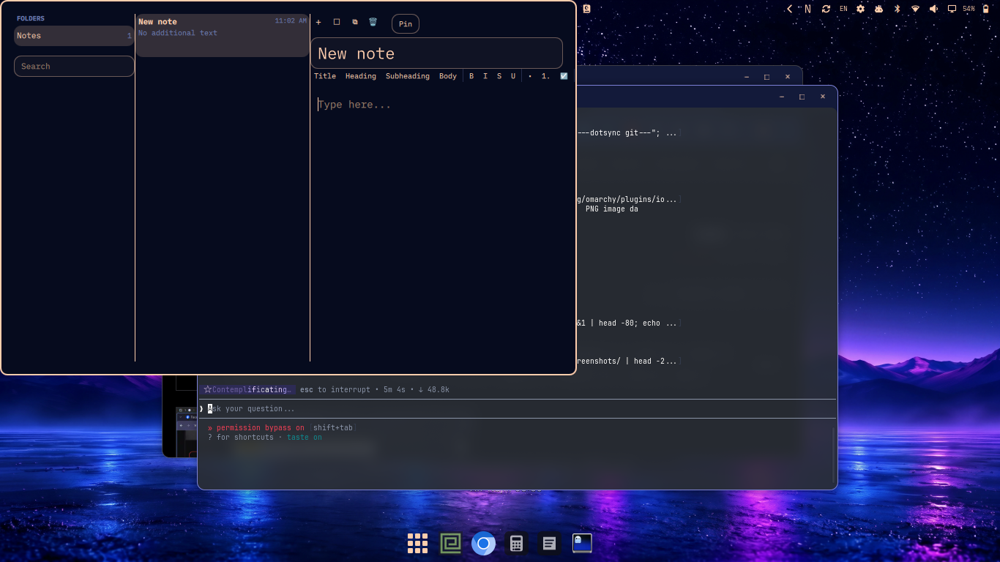

# Notes

A macOS Notes-style notes app for [Omarchy](https://omarchy.org/). Three-pane
Notes window — folders, note list, Markdown editor — that also opens as a
floating Quick Note flyout from the bottom-right hot corner. Dark/light mode
follows the Omarchy theme automatically.



## Features

- **Three panes**: Recents-style note list (title, relative date, preview,
  pinned notes on top) beside a Markdown editor.
- **Full note management**: create, rename, duplicate, pin, trash/restore,
  delete forever.
- **Instant search**: filters by title and body as you type.
- **Markdown editor** with a macOS-style formatting bar: Title/Heading/
  Subheading/Body, bold/italic/strikethrough/underline, bullet & numbered
  lists, checklist with toggleable checkboxes, table / horizontal-rule /
  timestamp insertion. Preview mode renders Markdown as rich text.
- **Auto-save**: every change is debounced (300 ms) and written atomically
  to `~/.local/state/omarchy/notes/notes.json` — no note loss on reload or
  tab switch. Reads are guarded against symlinks, non-regular files, and
  oversized input (4 MB ceiling), so a corrupt file starts fresh instead
  of wedging the shell.
- **Undo/redo**: per-session undo stack for typing bursts, format-bar
  actions, and cross-note edits (Ctrl+Z / Ctrl+Shift+Z).
- **Keyboard shortcuts**: `Ctrl+N` new note, `Ctrl+Shift+P` pin,
  `Ctrl+F` search, `Ctrl+Backspace` trash, `Esc` close.
- **Bar widget**: optional icon in the bar (right section by default).
- **Hot corner**: bottom-right dwell (150 ms, 4 px trigger from
  `~/.config/omarchy/hotcorners.json`) opens a persistent Quick Note
  scratchpad as a floating flyout that slides/scale-animates in from the
  corner. Collapse to a mini square, expand, open full, or dismiss with
  `Esc` / clicking outside.

## Install

This plugin is **already installed and enabled** on this machine at
`~/.config/omarchy/plugins/io.github.nomanur.notes`. To install it on
another Omarchy machine, copy the plugin folder there and enable it:

```
omarchy plugin enable io.github.nomanur.notes
```

Or add it from a git URL (if you publish it):

```
omarchy plugin add <git-url> --enable
```

Add the bar icon (optional):

```
omarchy bar put io.github.nomanur.notes --section right
```

Hide it (the keybind and hot corner keep working):

```
omarchy bar set io.github.nomanur.notes showIcon false --json
```

Bring it back:

```
omarchy bar set io.github.nomanur.notes showIcon true --json
```

## Usage

- Open full window: bar icon, or
  `omarchy-shell shell toggle io.github.nomanur.notes`.
- Quick Note: hover the bottom-right corner (dwell 150 ms), or
  `omarchy-shell shell summon io.github.nomanur.notes '{"mode":"quick"}'`.
- `Esc` closes. In quick mode, `Esc` first collapses to the mini square;
  `Esc` again hides.

The hot corner reads `~/.config/omarchy/hotcorners.json` (`triggerSize`,
`dwellMs`, `cooldownMs`) — an explicit non-empty `action` on
`bottom-right` there disables this plugin's corner, so you can assign the
corner to something else.

## Keybinds

Add these to `~/.config/hypr/bindings.lua` (or via your keybind UI):

```lua
o.bind("CTRL + N", "Notes: new note", "omarchy-shell shell summon io.github.nomanur.notes '{\"mode\":\"full\"}'")
```

Careful: `CTRL + N` is often bound to "new window". The plugin's panel
shortcuts (`Ctrl+N`, `Ctrl+Shift+P`, `Ctrl+F`, `Ctrl+Backspace`) work
*inside* the open window; a global Hyprland binding for the same combo
will fire first. Pick a global toggle combo that's free, e.g.
`SUPER + N` for toggle:

```lua
o.bind("SUPER + R", "Toggle Notes", "omarchy-shell shell toggle io.github.nomanur.notes")
```

## What it writes

| Path | When |
|---|---|
| `~/.local/state/omarchy/notes/notes.json` | debounced 300 ms after any edit; read at startup and on external change |
| `~/.config/omarchy/hotcorners.json` | read only (if present), watched for changes |
| `~/.config/omarchy/shell.json` | read only by the shell host; the plugin itself only writes via `omarchy plugin enable` |

The plugin also runs `python3` (safe file reader) and `mkdir` through
Quickshell's `Process`. Every path it touches is in the table above.

## State files

- `~/.local/state/omarchy/notes/notes.json` — folders, notes, and window
  settings. Delete the file to reset.

## Architecture

```
manifest.json     plugin registration (panel + service + bar-widget)
Panel.qml         main window: full 3-pane / quick flyout, store, undo
Service.qml       always-on half: hosts HotCorner, IPC surface
HotCorner.qml     bottom-right corner listener (dwell + cooldown)
BarWidget.qml     bar icon
NotesSidebar.qml  folders + trash + search source
NotesList.qml     note rows (title/date/preview), pinned-first
NotesEditor.qml   title + TextArea Markdown editor + Preview
FormatBar.qml     formatting bar (headings, styles, lists, inserts)
NoteStore.js      pure logic: model, search, serialize/deserialize
Markdown.js       pure logic: format/insert operations on Markdown
```

## License

MIT — see [LICENSE](LICENSE).
